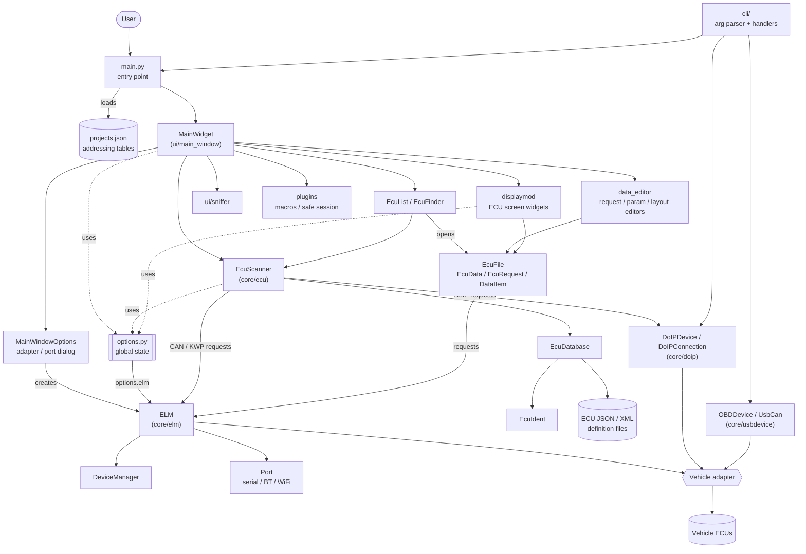
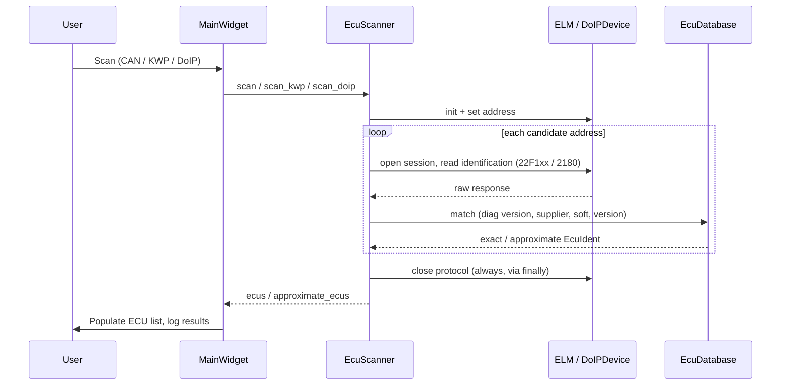

# DDT4All – Project Overview

DDT4All is a PyQt5 desktop application (with a small CLI) for diagnosing vehicle ECUs. It reads Renault DDT2000-style ECU description files (JSON/XML), talks to the vehicle through an adapter (ELM327-like, OBDLink, USB-CAN, or DoIP over Ethernet), and lets the user scan for ECUs, read/write parameters, and design/edit screens.

## Repository layout

| Path | Purpose |
|------|---------|
| `src/ddt4all/main.py`, `__main__.py` | Entry point: loads `projects.json`, builds the Qt app, parses CLI args |
| `src/ddt4all/options.py` | Global runtime state (`options.elm`, `options.simulation_mode`, `options.configuration`, `options.ecu_scanner`, `options.main_window`) and translator |
| `src/ddt4all/file_manager.py` | Locations of config, JSON database, logs and `projects.json` |
| `src/ddt4all/cli/` | Argument parser and command handlers (`doip`, `parameters`, `usbdevice`) |
| `src/ddt4all/core/ecu/` | ECU model: database, identification, scanner, file/request/data definitions |
| `src/ddt4all/core/elm/` | `ELM` adapter driver (serial/Bluetooth/WiFi), `Port`, `DeviceManager` |
| `src/ddt4all/core/doip/` | DoIP (ISO 13400) connection, device and message types |
| `src/ddt4all/core/usbdevice/` | `OBDDevice` and `UsbCan` USB adapters |
| `src/ddt4all/ui/main_window/` | Main window, ECU list, ECU finder, options dialog |
| `src/ddt4all/ui/displaymod/` | Runtime widgets that render ECU screens (labels, inputs, buttons, displays) |
| `src/ddt4all/ui/data_editor/` | Editors for requests, data items, parameters and screen layout |
| `src/ddt4all/ui/parameters/`, `ui/sniffer/` | Parameter commands/widgets and CAN sniffer |
| `src/ddt4all/plugins/` | Optional plugins (e.g. `cmd_macros_lib` macros and safe-session handling) |
| `src/ddt4all/generated/` | Compiled Qt resources and generated locale files |
| `locales/`, `resources/`, `scripts/` | Translations, icons/assets, i18n and resource-generation scripts |
| `setup_tools/` | Packaging (AppImage, Inno Setup, macOS) |
| `tests/` | `unit`, `integration`, `smoke` tests |
| `documentation/ddt4all/` | Per-module reference docs (plus `*_easylang.md` plain-language versions) |

## Main components

- **Application shell** – `main.py` loads vehicle/addressing data from `projects.json` into `ecu_database` and `elm` (address tables `dnat`, `snat`, ...), then starts `MainWidget`.
- **`MainWidget`** – the main window. Owns the `EcuScanner`, the ECU list, log view, progress/status bars, and opens ECU screens.
- **`MainWindowOptions`** – dialog to choose adapter/port/speed and options; creates the `ELM` instance stored in `options.elm`.
- **`EcuDatabase`** – indexes all known ECU definitions (`EcuIdent`) by address, protocol, diagnostic version, supplier, software and version.
- **`EcuScanner`** – walks the candidate addresses (CAN, KWP2000, DoIP), sends identification requests, parses replies, and matches them (exactly or approximately) to `EcuIdent` entries from the database.
- **`EcuFile` / `EcuData` / `EcuRequest` / `DataItem` / `EcuDevice`** – parsed representation of one ECU description: requests, data items, and screen layouts.
- **`ELM` + `DeviceManager` + `Port`** – low-level adapter communication: AT commands, CAN/ISO-TP and K-line framing, requests with caching, session control. `DeviceManager` initialises adapter-specific features.
- **`DoIPDevice` / `DoIPConnection`** – diagnostics over Ethernet.
- **`OBDDevice` / `UsbCan`** – USB adapters.
- **UI display and editing** – `displaymod` renders ECU screens and sends requests through `options.elm`; `data_editor` edits the ECU definitions.

## Component relationships

## ECU scan flow

Errors raised during a scan are handled per address in `EcuScanner` and reported to the user by `MainWidget._run_scan_safely`.

## Further reading

Per-module references live in `documentation/ddt4all/core/` (`ecu`, `elm`, `doip`, `usbdevice`); each module has a technical `.md` and a plain-language `*_easylang.md`.
