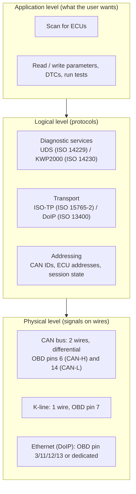
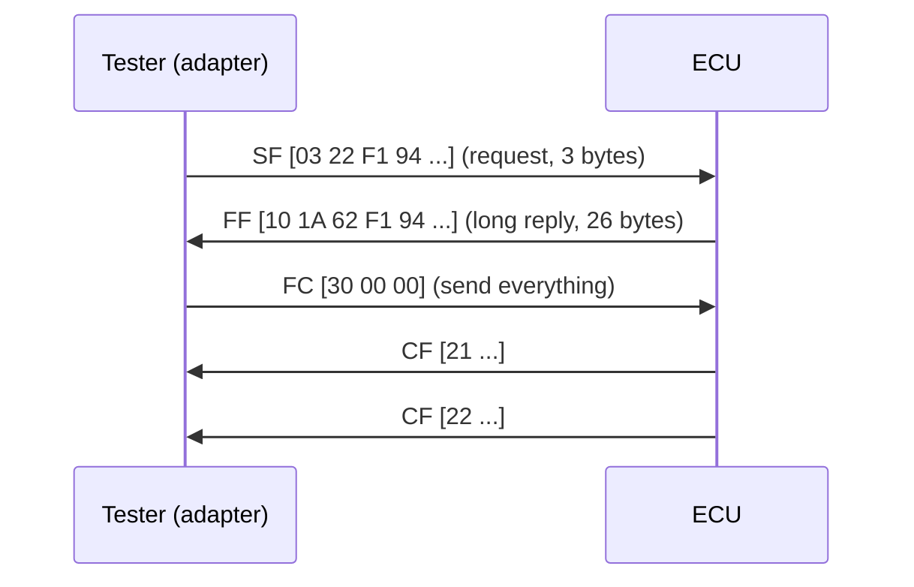
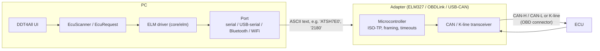

# ECU Communication Protocols – From Application to Wire

This document explains how DDT4All talks to a vehicle ECU, top-down: **application level → logical (protocol) level → physical level**. For the software structure see [overview.md](overview.md).

## 1. Vocabulary

| Term | Meaning |
|------|---------|
| **ECU** | Electronic Control Unit: an embedded computer in the car (engine, ABS, airbag, body/UCH, instrument cluster, ...). Each has a diagnostic address. |
| **OBD / OBD-II** | Legally mandated emissions-diagnostics standard (SAE J1979 / ISO 15031). Standard connector (SAE J1962, 16 pins) and a small standard set of "modes" (e.g. 01 live data, 03 stored DTCs, 04 clear DTCs). Only covers emission-related ECUs. |
| **EOBD** | European flavour of OBD-II. |
| **Manufacturer diagnostics** | Extended, ECU-specific services (read/write parameters, actuator tests, coding, reprogramming). This is what DDT4All uses; it rides on the same connector and bus. |
| **CAN** | Controller Area Network (ISO 11898): the multi-drop bus most modern ECUs use. Frames carry up to 8 data bytes (CAN FD: 64). |
| **ISO-TP** | ISO 15765-2: transport layer that splits/reassembles messages longer than one CAN frame. |
| **UDS** | Unified Diagnostic Services (ISO 14229): the modern diagnostic application protocol (service IDs `10`, `22`, `2E`, `27`, `31`, ...). |
| **KWP2000** | Keyword Protocol 2000 (ISO 14230): the older diagnostic protocol, used on K-line and also on CAN (ISO 15765). Many Renault ECUs use it. |
| **K-line / ISO 9141 / ISO 14230** | Single-wire serial bus (pin 7 of the OBD connector) used by older ECUs. |
| **DoIP** | Diagnostics over IP (ISO 13400): UDS/KWP-style messages carried over TCP/Ethernet. |
| **ELM327 / OBDLink** | Microcontroller-based adapters that translate text commands from the PC into CAN / K-line signals. |

## 2. The big picture



This follows the OSI idea: each level only talks to the one below it.

## 3. High level – what DDT4All does

From the user's point of view there are three jobs:

1. **Scan**: discover which ECUs are present and match them to an ECU description file (the database in `ecu_database.py`).
2. **Read/write**: open an ECU screen (built from `EcuFile` definitions) and show live parameters, DTCs, or send commands.
3. **Edit / macros**: create or modify ECU descriptions and run scripted sequences.

Every one of these ends up as the same primitive: **send a request (a few bytes) to one ECU and read its response**. For example:

| Goal | Request | Positive response |
|------|---------|-------------------|
| Enter extended session (UDS) | `10 03` | `50 03 ...` |
| Enter ECU "start diagnostic session" (KWP, Renault) | `10 C0` | `50 C0` |
| Read ECU identification (KWP) | `21 80` | `61 80 <ident data>` |
| Read diag version / supplier / soft / version (UDS) | `22 F1 A0`, `22 F1 8A`, `22 F1 94`, `22 F1 95` | `62 F1 xx <data>` |
| Keep session alive (tester present) | `3E 00` | `7E 00` |
| Negative response | any | `7F <service> <reason code>` |

A positive response SID is the request SID + `0x40` (`10`→`50`, `21`→`61`, `22`→`62`). A negative response always starts with `7F`.

In code the scanner (`core/ecu/ecu_scanner.py`) issues these requests via `options.elm.request(...)`; ECU screens do the same through `EcuRequest` objects.

## 4. Logical level

### 4.1 Addressing

Each ECU has a **diagnostic address** (e.g. `04` = ABS, `7A` = ECM in DDT naming). DDT4All keeps address tables from `projects.json` (`dnat`, `snat`, `dnat_ext`, `snat_ext`) mapping an ECU address to the CAN identifiers used:

- **Tester → ECU** ("request ID", `snat`/`dnat` pair depending on direction), e.g. `0x7E0`.
- **ECU → Tester** ("response ID"), e.g. `0x7E8` (request + 8 for standard OBD-II).

The adapter is told which IDs to use (see `ELM.set_can_addr` / `set_iso_addr`), so only that ECU's frames are sent and received. Extended addressing (`*_ext`) places the ECU address in the first data byte instead of in the CAN ID.

### 4.2 Transport: ISO-TP over CAN

A CAN frame carries 8 bytes, but a diagnostic response can be hundreds of bytes. ISO-TP adds a 1-byte header (PCI) in the first data byte:

| Frame type | PCI | Purpose |
|------------|-----|---------|
| Single Frame (SF) | `0x` | whole message ≤ 7 bytes, `x` = length |
| First Frame (FF) | `1x xx` | start of a long message, 12-bit total length |
| Consecutive Frame (CF) | `2n` | continuation, `n` = rolling sequence 0–F |
| Flow Control (FC) | `30 BS STmin` | receiver tells sender how many frames to send and how fast |



With an ELM327 you normally do **not** build these frames yourself: the chip performs ISO-TP segmentation, flow control and reassembly, and returns the final payload as text.

### 4.3 KWP2000 / UDS services

- **KWP2000** (ISO 14230) – services like `10` StartDiagnosticSession, `21` ReadDataByLocalIdentifier, `3B` WriteDataByLocalIdentifier, `14` ClearDTC, `18` ReadDTCByStatus. Used on K-line (with its own framing and *fast/slow init*) and on CAN (carried via ISO-TP).
- **UDS** (ISO 14229) – services like `10` DiagnosticSessionControl, `22` ReadDataByIdentifier (16-bit DIDs such as `F190` VIN, `F1A0` diag version), `2E` WriteDataByIdentifier, `27` SecurityAccess, `31` RoutineControl, `3E` TesterPresent. Used on newer ECUs.
- **OBD-II (J1979)** – "modes" `01`–`0A` addressed to the *functional* ID `0x7DF` (broadcast to all emission ECUs) or the physical IDs `0x7E0..0x7E7`. A subset of the same ideas as UDS/KWP.

DDT4All's scanner tries the **UDS** identification (`10 03`, then `22 F1 xx`) first and falls back to the **KWP** one (`10 C0`, `21 80`) if the ECU does not answer positively; `scan_kwp` uses the K-line/ISO path.

### 4.4 Sessions

ECUs start in a *default session* with limited services. A diagnostic session request (`10 03` extended, `10 C0` Renault KWP) unlocks more. The ECU falls back to default if it receives no traffic for a few seconds, hence **TesterPresent** (`3E`) keep-alive messages. After a scan, DDT4All explicitly returns each ECU to its default session (`10 01` / `10 81`) so it stops broadcasting and does not disturb the next connection.

### 4.5 DoIP

DoIP wraps the same diagnostic messages in an Ethernet protocol:

1. UDP discovery/vehicle announcement (port 13400).
2. TCP connection to the gateway, **routing activation** to register the tester's logical address.
3. **Diagnostic messages** carrying source address, target address and the UDS/KWP payload.

No ISO-TP is needed (TCP handles reliability and size). In DDT4All see `core/doip/` and `EcuScanner.scan_doip` (target IP/port from `options`).

## 5. Physical level

### 5.1 The OBD-II connector (SAE J1962)

| Pin | Signal |
|-----|--------|
| 4 / 5 | Chassis / signal ground |
| 16 | Battery +12 V |
| 6 / 14 | CAN-H / CAN-L (ISO 15765, high-speed CAN, 500 kbit/s typical; 250 kbit/s on some) |
| 7 | K-line (ISO 9141-2 / ISO 14230) |
| 15 | L-line (rare, legacy) |
| 3 / 11 | Alternative CAN (e.g. Renault multiplexed CAN at 250k/500k on other pins; varies by car) |
| 3, 11, 12, 13 (DoIP variant) | Ethernet TX/RX pairs and activation line (pin 8) |

Which pins/speeds are available **depends on the vehicle**; DDT4All lets the user choose the CAN line (`canlinecombo`) and speed.

### 5.2 CAN signalling

- Two wires with differential voltage (CAN-H ≈ 2.5–3.5 V, CAN-L ≈ 1.5–2.5 V). A 120 Ω termination at each end of the bus.
- Bits are arbitrated by message ID (lower ID wins); frames carry ID, DLC, up to 8 data bytes and a CRC. The CAN controller handles ACK, error detection and retransmission.
- A wrong bit rate causes error frames, which is a typical cause of "NO DATA" or `CAN ERROR` from the adapter.

### 5.3 K-line

Single wire, 10.4 kbit/s (ISO 9141) or up to ~10 kbit/s with ISO 14230. Connection starts with an **initialisation**: *5-baud init* (slow) or a *fast init* wake-up pulse (25 ms low/25 ms high), then a key-word exchange.

## 6. The path from DDT4All to the ECU



Layer-by-layer for one request, e.g. "read ECU identification" (`21 80`) from an ECU:

| Layer | What happens |
|-------|--------------|
| Application (DDT4All) | `EcuScanner.identify_*` calls `options.elm.request(req='2180', positive='61')` |
| ELM driver (`core/elm/elm.py`) | Ensures the right CAN IDs/headers are configured (`ATSH`, `ATCRA`, `ATFCSH`, ...), sends the request, handles retries, caching, and "NO DATA"/`7F` replies |
| Port (`core/elm/port.py`) | Writes ASCII bytes + `\r` to the serial/Bluetooth/WiFi stream and reads until the `>` prompt |
| Adapter firmware | Builds the ISO-TP single frame `03 21 80 00 00 00 00 00`, puts it on the bus, collects reply frames, reassembles, returns hex text |
| CAN transceiver | Converts logic levels to the differential bus voltages |
| ECU | Its CAN controller accepts the frame by ID, the ISO-TP stack and diagnostic stack process it, and the answer travels the opposite way |

Typical ELM327 conversation (text, not raw frames):

```text
> ATZ                 reset
> ATE0                echo off
> ATSP6               protocol 6 = ISO 15765-4, 11-bit, 500 kbit/s
> ATSH 7E0            request CAN ID
> ATCRA 7E8           accept only this response ID
> 10C0                start diagnostic session
< 50 C0
> 2180                read identification
< 61 80 82 00 45 15 ...
```

Common ELM protocol numbers: `3` ISO 9141-2, `4` ISO 14230 slow init, `5` ISO 14230 fast init, `6` CAN 11-bit/500k, `7` CAN 29-bit/500k, `8`/`9` CAN 11/29-bit at 250k.

## 7. Adapter types supported

| Adapter | Link to PC | Notes |
|---------|-----------|-------|
| ELM327 (and clones) | USB-serial, Bluetooth, WiFi | AT-command text interface; many clones are incomplete or slow. |
| OBDLink (SX/MX/EX…) | USB / Bluetooth | ELM-compatible plus extensions (`ST` commands); see `documentation/obdlink`. |
| USB-CAN (`core/usbdevice/usb_can.py`) | USB | Raw CAN frames; the host side handles framing. |
| DoIP | Ethernet / WiFi | Direct TCP to the vehicle gateway (`core/doip`). |
| Simulation mode | none | No hardware; canned responses used for development (`options.simulation_mode`). |

## 8. Typical failure modes

| Symptom | Likely cause |
|---------|--------------|
| `NO DATA`, timeout | ECU absent/asleep, wrong CAN IDs/speed, wrong CAN line, ignition off |
| `CAN ERROR`, `BUS INIT: ERROR` | Wrong bit rate or protocol, wiring/termination problem |
| `7F xx 10/11/12` | Service/sub-function not supported by this ECU |
| `7F xx 22` | Conditions not correct (e.g. engine running, wrong session) |
| `7F xx 33/35/36` | Security access required / invalid key / too many attempts |
| `7F xx 78` | Response pending – ECU is busy, keep waiting |
| Garbled/short reply | Cheap adapter, buffer overrun, bad baud rate; the scanner now skips such replies instead of crashing |

## 9. Safety notes

- Writing parameters, coding or reprogramming can permanently affect vehicle behaviour. Do it only with stable power and a good adapter.
- Broadcasting wake-up/session frames on a live bus can disturb running ECUs; prefer scanning with the ignition on and the engine off.

## 10. Further reading

- ISO 11898 (CAN), ISO 15765 (CAN transport + diagnostics), ISO 14229 (UDS), ISO 14230 (KWP2000), ISO 9141, ISO 13400 (DoIP), SAE J1979 / J1962.
- ELM327 datasheet (Elm Electronics) for the AT command set.
